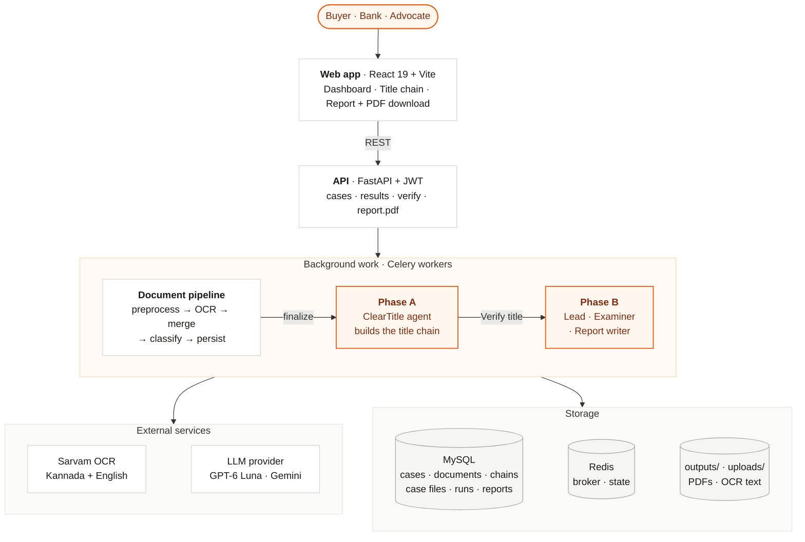
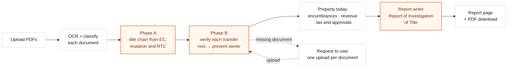
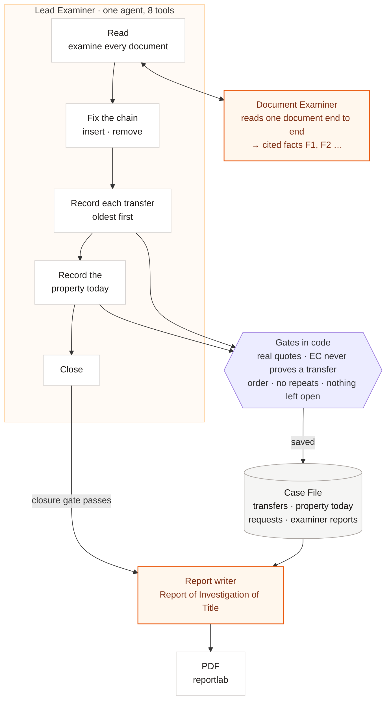

# clearTitle — AI Property Title Verification

An end-to-end title verification platform for **Karnataka property documents**. clearTitle reads scanned PDFs with Sarvam OCR and classifies each one. A **ClearTitle agent** then rebuilds the title chain from the property's history documents (Phase A). A **verification agent** checks every transfer from the root owner, 30 years back, to the present owner (Phase B). Finally a report writer produces an advocate-style **Report of Investigation of Title**, which the user can read on the page or download as a PDF.

---

## Highlights

- **Agents reason, the application enforces process.** The model decides what proves a transfer and how serious a problem is. Code enforces the process: full reads before citing, real quotes, transfers verified oldest first, and no closing while anything is left.
- **One complete record per transfer.** For each transfer the agent records the property, how it connects to the transfer before, the documents that prove it (found with citations, or missing), and its concerns. Code works out the result: verified, verified with concerns, waiting for documents, or defective.
- **Missing documents become requests, not guesses.** Each missing document becomes a request to the user, with one upload button per document. An upload re-checks only the transfers that need it.
- **Advocate-style report.** Particulars, documents scrutinised, details of each document, history of title, certificate, and an annexure of documents still required. Code checks it against the records: no invented document numbers, every examined document covered, and the right present owners named.
- **Honest failures.** A run that hits its call budget or cost cap stops as `incomplete` and keeps its progress. Errors show as `error`. A result is never fabricated.

---

## System Architecture



### How a case flows



### Key Components

| Component | Technology | Description |
|---|---|---|
| **Frontend** | React 19, Vite 6, TypeScript, Tailwind CSS 4 | Landing page, plus a dashboard with live agent steps, the title chain page and the report page |
| **API layer** | FastAPI, Uvicorn | REST API with JWT auth (optional Google OAuth) for cases, results, verification and the PDF report |
| **Async tasks** | Celery, Redis | Idempotent pipeline stages, chain build and verification runs |
| **OCR** | Sarvam AI Vision OCR | Mixed Kannada/English text; PDFs over 10 pages are split into overlapping chunks |
| **Agents** | Pydantic AI; OpenAI (`GPT-6 Luna`) by default, Gemini optional | ClearTitle agent (Phase A); Lead, Document Examiner and Report writer (Phase B) |
| **PDF report** | reportlab | Renders the advocate-style report, with no system libraries needed |
| **Database** | MySQL | Users, cases, documents, title chains, verification case files, runs, events, reports |

---

## Phase A — How the Title Chain Is Built

The application's job is to make dishonest shortcuts impossible; the agent's job is to reason over evidence. The chain builder works **history-first**:

1. **List the documents** from their summaries.
2. **Read every history document in full**: the encumbrance certificate, mutation records and RTC (pahani). Property register cards are excluded.
3. **Open title deeds only on the path**: to extend the chain back through a deed recital, or to settle a history entry that OCR left unclear.
4. **Save the chain**: property identity, ordered transactions, and the documents still needed.

| Guarantee | Rule |
|---|---|
| **History-first** | The chain can only be built after every uploaded history document was read end to end |
| **Full-OCR gate** | A completed chain is rejected unless every selected document was read end to end in this session |
| **Citation validation** | Every source points at a history document or title deed that was read end to end |
| **No candidate suggestion** | No keyword matcher; the agent alone decides what to read |
| **No misleading completion** | With no history document, the agent pauses and asks for the Encumbrance Certificate |

---

## Phase B — How Verification Works



**The Case File** is the agent's memory: one JSON document per case (`verification_case_files`), saved after every step, so a run can be resumed or continued.

| Part | What it holds | Written by |
|---|---|---|
| `transfers[]` | Each transfer from Phase A, plus its record: property, connection to the previous transfer, documents (found with citations, or missing), concerns, summary | Lead (`record_transfer`) |
| `property_today` | Encumbrances, revenue records, tax and approvals: a note, documents and concerns for each | Lead (`record_property_today`) |
| `requests[]` | Documents asked of the user, filed and closed automatically from the missing documents | Code |
| `documents{}` | Each document's examiner report: cited facts, recitals, unexpected findings | Document Examiner |

**Results are worked out by code, never chosen by the model.** Any high concern, or a break with no missing document, makes a transfer `defective`. Otherwise a missing document makes it `documents_missing`, and any concern makes it `verified_with_concerns`. With none of these it is `verified`. The writer decides the opinion (`CLEAR`, `CLEAR_SUBJECT_TO` or `NOT_CLEAR`), and a gate checks that it agrees with the records.

**Lead tools:** `view_case_file`, `examine_document`, `read_pages`, `record_transfer`, `insert_transfer`, `remove_transfer`, `record_property_today`, `set_aside`. The tools that change the Case File run one at a time.

**When documents arrive:** an upload for a request starts an incremental run. The Lead examines only the new document, records again the transfers that request is for, and a new report version lists what changed.

---

## The Report

The report writer produces a **Report of Investigation of Title** in the form a Karnataka advocate uses. It appears on the report page and downloads as a PDF (`GET /api/verify/{case_id}/report.pdf`).

| Section | Content |
|---|---|
| I. Particulars | Present title holder(s); complete property description with boundaries |
| II. Documents scrutinised | Sl. No., date, nature of document, copy type |
| III. Details of documents | One paragraph per document: number, date, parties, property, what it records |
| IV. History of title | "Originally … Thereafter …", ending with the present owners and any subsisting charge |
| V. Certificate | The opinion and the conditions it is subject to |
| Annexure | Documents still required (from the open requests) |
| Signature | "Prepared by ClearTitle", to be reviewed and signed by an advocate |

Gates on the writer's output check:
- every examined document appears once, with one paragraph each;
- document and registration numbers appear in that document's facts;
- the title holders are the last transfer's buyers;
- no internal ids, Kannada script or mention of OCR appear;
- the opinion matches the records.

---

## Supported Document Types

| Category | Types |
|---|---|
| **Ownership & Transfer** | `SALE_DEED`, `GIFT_DEED`, `PARTITION_DEED` |
| **Government Registry** | `ENCUMBRANCE_CERTIFICATE` (EC), `PROPERTY_REGISTER_CARD` (PRC) |
| **Municipal & Tax** | `KHATA`, `PROPERTY_TAX_ASSESSMENT`, `TAX_RECEIPT`, `E_PAYMENT_RECEIPT` |
| **Revenue & Clearances** | `MUTATION`, `CONVERSION_ORDER`, `POSSESSION_CERTIFICATE` |
| **Legal & Others** | `RTC_PAHANI`, `LEGAL_HEIR_CERTIFICATE`, `COURT_ORDER` |

Classification runs an LLM over a bounded OCR prefix, with deterministic rules for known formats such as Karnataka Form 9. It writes a 2–3 sentence summary in the same call. No full-document model read happens at upload; the Document Examiner reads each document once, in full, during verification.

---

## Quick Start (Docker)

> **Only requirement:** [Docker Desktop](https://www.docker.com/products/docker-desktop/). No Python, MySQL or Redis needed on your machine.

### 1. Clone and configure

```bash
git clone https://github.com/MyMane24/clearTitle.git
cd clearTitle
cp .env.example .env
```

Open `.env` and fill in the API keys (everything else works as-is):

```env
SARVAM_API_KEY=your_key_here
OPENAI_API_KEY=your_key_here
DOCUMENT_PROCESSOR_MODEL=gpt-6-luna

# Agents (OpenAI by default)
CLEARTITLE_AGENT_PROVIDER=openai
CLEARTITLE_AGENT_MODEL=gpt-6-luna

# Optional: a different model per verification role
# VERIFY_LEAD_MODEL=...
# VERIFY_EXAMINER_MODEL=...
# VERIFY_REPORT_MODEL=...

# Optional: Gemini instead of OpenAI
# CLEARTITLE_AGENT_PROVIDER=gemini
# GEMINI_API_KEY=your_key_here

# Optional: Google OAuth ("Continue with Google")
# GOOGLE_CLIENT_ID=...
# GOOGLE_CLIENT_SECRET=...
# GOOGLE_REDIRECT_URI=http://localhost:8000/auth/google/callback
```

### 2. Start everything

```bash
docker compose up --build
```

| Service | URL / Port | Purpose |
|---|---|---|
| **App (FastAPI + React SPA)** | http://localhost:8000 | Main application; open `/#/app` for the dashboard |
| **phpMyAdmin** | http://localhost:8080 | Browse MySQL data in the browser |
| **MySQL** | `127.0.0.1:3307` | Database (exposed for GUI tools) |
| **Redis** | internal only | Celery broker + state store |
| **Celery Worker** | internal only | Pipeline, chain build and verification runs |

Rebuild with `docker compose up --build` after changing code: the React SPA is baked into the image. Tag the current image before a risky change (see [Backup & Rollback](#backup--rollback)).

### 3. Verify a property

1. Open `/#/app`, upload the property PDFs and press **Process**. The five-stage pipeline runs live.
2. When processing completes, **Phase A** builds the title chain. If no history document was uploaded, the dashboard asks for the Encumbrance Certificate.
3. Press **Verify title**. The verification steps appear live as the agent works through each transfer.
4. The **Title chain** page shows each transfer with its documents, concerns and result, plus the property today.
5. The **Verification report** page shows the advocate-style report and the documents still needed, with an **Upload** button for each. **Download PDF** saves the report.

---

## Frontend Development (Without Docker)

```bash
cd frontend
npm install
npm run dev            # http://localhost:3000
```

| Command | Description |
|---|---|
| `npm run dev` | Dev server (Express + Vite middleware) on :3000 |
| `npm run build` | Build the Vite frontend + bundle the server to `dist/` |
| `npm run lint` | Type-check with `tsc --noEmit` |
| `npm run test` | Unit tests for the results pages (`node --test` + tsx) |
| `npm start` | Run the production server from `dist/` |

When deployed via Docker, the built SPA is served by FastAPI from `frontend/dist`.

---

## Inspecting the Database

**phpMyAdmin:** open http://localhost:8080. Tables: `users`, `cases`, `documents`, `title_chains`, `verification_case_files`, `verification_runs`, `verification_events`, `due_diligence_reports`.

**GUI client** (MySQL Workbench, DBeaver, TablePlus): host `127.0.0.1`, port `3307`, user `root`, password `password`, database `property_ocr_v2`.

**Terminal:**

```bash
docker compose exec mysql mysql -u root -ppassword property_ocr_v2
```

---

## API Endpoints

### Auth
| Method | Endpoint | Description |
|---|---|---|
| `POST` | `/api/auth/register` | Register a new account |
| `POST` | `/api/auth/login` | Log in, returns a JWT |
| `GET` | `/api/auth/me` | Current user (requires Bearer token) |
| `GET` | `/auth/google/login` | Start Google OAuth (when configured) |
| `GET` | `/auth/google/callback` | Google OAuth callback |

### Pipeline & Cases
| Method | Endpoint | Description |
|---|---|---|
| `GET` | `/api/cases` | List cases (requires auth) |
| `POST` | `/api/upload` | Upload PDFs and start a new case |
| `POST` | `/api/process/{case_id}` | Run the OCR + classification pipeline |
| `GET` | `/api/status/{case_id}` | Live pipeline status |
| `POST` | `/api/retry/{case_id}` | Retry failed documents |
| `POST` | `/api/case/{case_id}/upload` | Add documents to an existing case |
| `POST` | `/api/case/{case_id}/link` | Link a guest case to the logged-in account |
| `POST` | `/api/case/{case_id}/doc/{doc_id}/replace` | Replace a document file |
| `POST` | `/api/case/{case_id}/doc/{doc_id}/skip` | Mark a document as skipped |
| `GET` | `/api/case/{case_id}/doc/{doc_id}/pdf` | Serve the original PDF |
| `DELETE` | `/api/case/{case_id}` | Delete a case (MySQL + files) |

### Title chain
| Method | Endpoint | Description |
|---|---|---|
| `GET` | `/api/results/{case_id}` | Case info, documents and the Phase A chain |
| `POST` | `/api/results/{case_id}/chain` | (Re)build the title chain |
| `GET` | `/api/results/{case_id}/ocr` | Raw OCR text for every document |

### Verification & report
| Method | Endpoint | Description |
|---|---|---|
| `POST` | `/api/verify/{case_id}?fresh=false` | Start or continue verification (`fresh=true` starts over) |
| `GET` | `/api/verify/{case_id}` | Case File, latest run and latest report |
| `GET` | `/api/verify/{case_id}/events?after=N` | Live steps after event N |
| `GET` | `/api/verify/{case_id}/report.pdf` | The latest report as a PDF |
| `POST` | `/api/verify/{case_id}/requisitions/{request_id}/upload` | Upload a requested document; it is processed, then verified |

Most case endpoints accept an optional JWT. Guest cases work without auth; once linked, only the owner can access them.

---

## The Document Pipeline

Every uploaded PDF goes through **5 stages**, each an idempotent Celery task, joined by a **chord**:

```
DOC_001 --> preprocess --> ocr --> merge --> classify --> persist --+
DOC_002 --> preprocess --> ocr --> merge --> classify --> persist --+--> finalize --> title chain
DOC_003 --> preprocess --> ocr --> merge --> classify --> persist --+
```

| # | Stage | Work |
|---|---|---|
| 1 | **Preprocess** | CLAHE contrast, denoise, deskew, sharpen via OpenCV (falls back to the raw PDF) |
| 2 | **OCR** | Sarvam OCR (Kannada + English); over 10 pages, overlapping 10-page chunks in parallel |
| 3 | **Merge** | Deduplicate overlapping pages, re-join split tables, strip base64 blobs |
| 4 | **Classify** | LLM classifies a bounded OCR prefix and writes a short summary; rules handle known formats |
| 5 | **Persist** | Mark the document ready (`structured`) |

**Finalize** recomputes the case status and queues the chain build. Once verification has started for a case, new uploads go to an incremental verification run instead of a chain rebuild.

---

## Project Structure

```
clearTitle/
├── backend/                         # FastAPI + Celery
│   ├── main.py                      # FastAPI entrypoint (API + React SPA)
│   ├── celery_app.py                # Celery config
│   ├── config.py                    # every environment variable, in one place
│   ├── prompts/                     # LLM prompts as versioned .txt files
│   │   ├── title_chain_system.txt   #   Phase A: chain agent
│   │   ├── title_chain_task.txt     #   Phase A: chain task
│   │   ├── agent_summary.txt        #   per-document summaries
│   │   ├── verify_lead_system.txt   #   Phase B: Lead Examiner
│   │   ├── verify_examiner.txt      #   Phase B: Document Examiner
│   │   └── verify_report.txt        #   Phase B: report writer
│   ├── skills/                      # playbooks the agents load (application code)
│   │   ├── title_chain/             #   Phase A chain rules
│   │   └── verification/            #   Phase B method + topic playbooks
│   ├── routers/                     # HTTP only: auth, cases, results, verification
│   ├── services/
│   │   ├── document_processor.py    #   classification + summary
│   │   ├── chain_builder.py         #   Phase A title chain (Pydantic AI)
│   │   ├── cleartitle_agent.py      #   chain-build entrypoint and pauses
│   │   └── verification/            #   Phase B
│   │       ├── case_file.py         #     the Case File: records, results, migrations
│   │       ├── tools.py             #     the Lead's tools
│   │       ├── gates.py             #     process rules the agent cannot skip
│   │       ├── examiner.py          #     Document Examiner
│   │       ├── agents.py            #     Lead agent wiring + closure gate
│   │       ├── context.py           #     Case File snapshot + history compaction
│   │       ├── runner.py            #     one run: start to report
│   │       ├── report.py            #     report writer + its gates
│   │       ├── report_pdf.py        #     PDF rendering (reportlab)
│   │       └── service.py           #     public interface for routers and workers
│   ├── workers/                     # thin Celery task wrappers
│   ├── domain/                      # pure logic: state machine, chain continuity
│   ├── integrations/                # llm, ocr (Sarvam), redis, storage, document sources
│   ├── database/                    # connection, migrations (DDL at startup), repositories (all SQL)
│   ├── schemas/                     # chain and report contracts (Pydantic)
│   └── tests/                       # pytest suite
│
├── frontend/                        # React SPA (Vite)
│   └── src/
│       ├── components/              # landing-page sections
│       ├── dashboard/
│       │   ├── VerificationDashboard.tsx   # dashboard shell: upload, processing, history
│       │   ├── results/             # title chain page, report page, PDF download
│       │   ├── verification/        # live step feed
│       │   └── dashboard.css        # dashboard styles
│       └── api/backend.ts           # typed API client
│
├── outputs/  uploads/  backups/     # data and snapshots (NOT in git)
├── docker-compose.yml               # api, worker, mysql, redis, phpmyadmin
├── Dockerfile                       # Node 20 builds the SPA → Python 3.11 runtime
└── requirements.txt
```

---

## Configuration (agents)

| Setting | Default | Meaning |
|---|---|---|
| `CLEARTITLE_AGENT_PROVIDER` | `openai` | `openai` or `gemini` |
| `CLEARTITLE_AGENT_MODEL` | `GPT-6 Luna` | Default model for every agent |
| `CLEARTITLE_CHAIN_MODEL_CALL_BUDGET` | `16` | Phase A model calls per chain build |
| `VERIFY_LEAD_MODEL` / `VERIFY_EXAMINER_MODEL` / `VERIFY_REPORT_MODEL` | agent model | Model per verification role |
| `VERIFY_LEAD_CALL_BUDGET` | `100` | Lead model calls per run before it stops as `incomplete` |
| `VERIFY_RUN_COST_LIMIT_USD` | `0.50` | Estimated cost cap per verification run |
| `VERIFY_COMPACT_AT_CHARS` | `30000` | History size at which old tool results are cleared |

---

## Tests

```bash
.\venv\Scripts\python.exe -m pytest backend/tests   # 253 tests
cd frontend
npm run test                                        # 23 tests
npm run lint                                        # tsc --noEmit
```

The backend suite asserts the process guarantees against the real handlers:
- Phase A: the full-OCR and history-first gates, and the pause for the EC;
- Phase B: citation and evidence rules, oldest-first order, request filing, the closure gate;
- the report gates;
- the PDF output.

Scripted models drive whole verification runs end to end with no real model calls.

---

## API Costs

| Provider | Use | Typical cost |
|---|---|---|
| **Sarvam AI** | OCR | Usage-based (free tier available) |
| **OpenAI** (`gpt-6-luna`) | Classification, Phase A, verification | A first verification run on a 20-document case is about $0.05–0.10, including examining every document. A re-run that reuses the saved examiner reports is about $0.02–0.03. Writing the report alone is about $0.01 |
| **Google Gemini** (optional) | Agents | Usage-based, when selected |

---

## UI Design System

- **Palette:** cream background (`#FFF8F2`), warm stone neutrals, an orange brand scale (`#ea580c`, `#f97316`), and emerald / amber / rose for results.
- **Typography:** Inter (body), Plus Jakarta Sans (headings), a serif for the report.
- **Icons:** lucide-react, no emoji.
- **Dashboard:** content sits on the page with hairline dividers, not cards. The title chain is a timeline with a coloured dot per result. The report page is set like the PDF.

---

## Backup & Rollback

The app is three independent layers. Each needs its own undo — `git` covers only the first.


| Layer | What it is | Recovered by |
|---|---|---|
| **Code** | `backend/`, `frontend/` | `git reset --hard <tag>` |
| **Running build** | Docker image — code **+ baked-in React SPA** | `docker tag` a known image back onto `:latest` |
| **Data** | MySQL `property_ocr_v2`, plus `outputs/` | `mysqldump` / file copy |

`git reset` alone does **not** roll back the running app: the React bundle is compiled into the image, and MySQL is never touched by git.

### What is not in version control

| Path | In git? | Consequence |
|---|---|---|
| `.env` | No (secrets) | Must be backed up separately, stored securely |
| `outputs/` | No | OCR text + structured JSON. **Irreplaceable** — recovering it means re-running paid OCR |
| `uploads/` | No | Original scanned PDFs. Re-uploadable from your own copies |
| `backups/` | No | Local dump snapshots (see below) |

### Take a database snapshot

```bash
mkdir -p backups                                    # Windows PowerShell: New-Item -ItemType Directory backups
docker compose exec -T mysql sh -c 'mysqldump -u root -p"$MYSQL_ROOT_PASSWORD" \
  --single-transaction --skip-lock-tables --no-tablespaces \
  --default-character-set=utf8mb4 --routines --triggers \
  --set-gtid-purged=OFF property_ocr_v2 > /tmp/db.sql'
docker compose cp mysql:/tmp/db.sql "backups/db-$(date +%F-%H%M%S).sql"
```

Why each flag matters:

| Flag | Reason |
|---|---|
| `--single-transaction` | Consistent snapshot of InnoDB tables with **no table locks** — the app keeps serving during the dump |
| `--skip-lock-tables` | Belt-and-braces: never take a global read lock |
| `--default-character-set=utf8mb4` | Kannada party names survive the round-trip |
| no `--databases` | Omits `CREATE DATABASE`/`USE`, so a restore can only touch the database you name explicitly |
| `docker compose cp` | Avoids piping binary through the host shell — PowerShell redirection corrupts UTF-8 |

### Restore a snapshot

> **This replaces the current contents of the target database** (the dump contains `DROP TABLE IF EXISTS`). Stop the app first and keep a fresh snapshot of anything you want to keep.

```bash
# 1. take a snapshot of the CURRENT state before overwriting it
# 2. stop everything that writes to MySQL
docker compose stop api worker

# 3. copy the dump in and restore it
docker compose cp backups/db-2026-10-05-pre-big-change.sql mysql:/tmp/restore.sql
docker compose exec -T mysql sh -c 'mysql -u root -p"$MYSQL_ROOT_PASSWORD" \
  -D property_ocr_v2 < /tmp/restore.sql'

docker compose up -d
```

### Roll back the running build

`docker compose up --build` overwrites the `:latest` tag, so a rebuild makes the previously working image unreachable. Name the image **before** you start changing things:

```bash
docker tag cleartitle-api:latest   cleartitle-api:<commit-sha>     # e.g. 68a4aaa
docker tag cleartitle-worker:latest cleartitle-worker:<commit-sha>
```

Later, to return to it without rebuilding:

```bash
docker tag cleartitle-api:<commit-sha>    cleartitle-api:latest
docker tag cleartitle-worker:<commit-sha> cleartitle-worker:latest
docker compose up -d --force-recreate --no-build
```

Always confirm an image really contains the code you think it does — a build from a dirty working tree can look fine while missing your newest commits:

```bash
# Linux / macOS
docker create --name chk cleartitle-api:<commit-sha>
docker cp chk:/app/backend/services/chain_builder.py /tmp/chain_builder.py
git hash-object /tmp/chain_builder.py
git rev-parse <commit-sha>:backend/services/chain_builder.py   # the two hashes must match
docker rm chk
```

```powershell
# Windows PowerShell
docker create --name chk cleartitle-api:<commit-sha>
docker cp chk:/app/backend/services/chain_builder.py "$env:TEMP\chain_builder.py"
git hash-object "$env:TEMP\chain_builder.py"
git rev-parse <commit-sha>:backend/services/chain_builder.py
docker rm chk
```

### Known-good baselines

| Date | Git tag / commit | Notes |
|---|---|---|
| **2026-10-29** | `working-2026-10-29` → `68a4aaa` | Schema v3.0 evidence contract, agent-only selection, compact single-pause requests, PDF fixes. Validated: 148/148 backend, 20/20 frontend, live case 390E1B54 end-to-end, full no-LLM runtime audit. |
| 2026-10-05 | `pre-big-change` → `b1196fc` | Pre-agent pipeline baseline. DB dump: `backups/db-2026-10-05-pre-big-change.sql` |

> `docker-compose.yml` sets no `image:` key, so `docker compose build` always writes to `:latest`. Tag explicitly before a risky change, as above.

---

## Manual Setup (Backend, Without Docker)

<details>
<summary>Click to expand — for local backend development without Docker</summary>

**Prerequisites:** Python 3.11+, MySQL 8.0, Redis

### Step 1 — Create the database

```sql
CREATE DATABASE IF NOT EXISTS property_ocr_v2
  CHARACTER SET utf8mb4 COLLATE utf8mb4_unicode_ci;
```

### Step 2 — Configure environment

```bash
# Windows
copy .env.example .env

# Linux / macOS
cp .env.example .env
```

Update these values to match your local MySQL:

```env
MYSQL_HOST=127.0.0.1
MYSQL_PORT=3306
MYSQL_USER=root
MYSQL_PASSWORD=your_mysql_password
MYSQL_DATABASE=property_ocr_v2
REDIS_URL=redis://localhost:6379/0
```

### Step 3 — Install dependencies

```bash
python -m venv venv
# Windows:  .\venv\Scripts\Activate.ps1
# Linux/macOS: source venv/bin/activate
pip install -r requirements.txt
```

### Step 4 — Run the application (3 terminals)

**Terminal 1 — Redis:** `redis-server`

**Terminal 2 — Celery Worker:**

Windows:
```powershell
.\venv\Scripts\celery.exe -A backend.celery_app worker --loglevel=info --pool=solo --concurrency=1
```
Linux / macOS:
```bash
celery -A backend.celery_app worker --loglevel=info --concurrency=2
```

**Terminal 3 — FastAPI Server:**

Windows:
```powershell
.\venv\Scripts\uvicorn.exe backend.main:app --reload --port 8000
```
Linux / macOS:
```bash
uvicorn backend.main:app --reload --port 8000
```

Open **http://localhost:8000** in your browser.

</details>

---

## Documentation

- **AGENTS.md** (local, gitignored): working notes for coding agents: layout, commands and the invariants the tests protect.

---

*Last updated: 24 November 2026*
