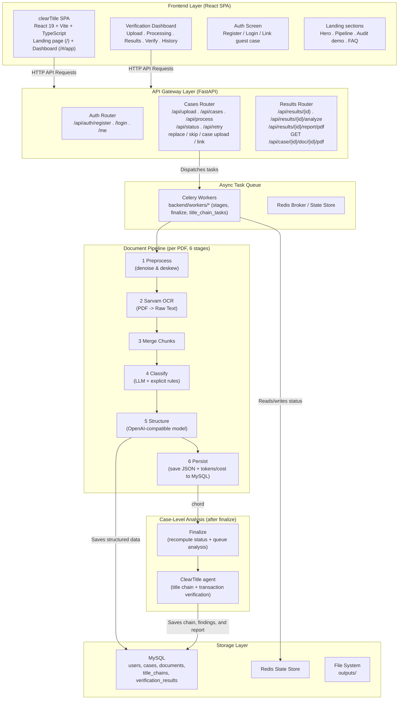

# clearTitle — AI Property Title Verification

An end-to-end property title verification platform for **Karnataka property documents**. clearTitle extracts structured JSON from scanned PDFs using Sarvam OCR and an OpenAI-compatible document processor, then runs a tool-using ClearTitle verification agent over stored structured data and OCR evidence.

---

## System Architecture



### Key Components

| Component | Technology | Description |
|---|---|---|
| **Frontend** | React 19, Vite 6, TypeScript, Tailwind CSS 4 | Landing page + admin dashboard with AI pipeline view, results, title-chain timeline, verification table, and case history |
| **API Layer** | FastAPI, Uvicorn | Async REST API with JWT auth for cases, documents, results, and analysis |
| **Async Tasks** | Celery, Redis | Idempotent background stages — preprocess, OCR, merge, classify, structure, persist, finalize, title-chain, verify |
| **OCR Service** | Sarvam AI Vision OCR | High-accuracy OCR for mixed English/Kannada text; chunks >10-page PDFs with overlap |
| **Document processing** | OpenAI-compatible API | Classification and full-text schema-based extraction |
| **Verification agent** | OpenAI by default; Gemini optional | Tool-calling analysis of persisted structured data and OCR |
| **Relational DB** | MySQL | Unified tables for users, cases, documents, title chains, and verification results |

---

## Verification Features

- **Title Chain** — every EC ledger transaction is classified (`THE_SD`, `PREDECESSOR_TITLE`, `SUBSEQUENT_TRANSFER`, `DIVERGENT_BRANCH`, `ENCUMBRANCE`, `UNRELATED`), sorted chronologically, and merged into a timeline.
- **Cross-Document Verification** — a field-by-field comparison (property identifiers, dates, parties, consideration) between the Sale Deed and the EC ledger, with a deterministic `VERIFIED` / `NOT_VERIFIED` / `N/A` verdict.
- **Khata-aware** — KHATA extracts get an A-Khata/B-Khata/authorized hint and khata-fee verification fields, plus a themed structured view (holders, property details, tax dues, certification).
- **EC page-split merge** — a ledger row split across consecutive pages (missing both date and registration reference) is recombined before verification/title-chain, so one transaction is never counted twice.
- **Self-Service Re-run** — every completed case can re-run verification and the title chain independently (`POST /api/results/{case_id}/verify`, `POST /api/results/{case_id}/title-chain`), or both at once (`POST /api/results/{case_id}/analyze`).
- **PDF Title Verification Report** — generates a professional legal-style PDF report per case (`GET /api/results/{case_id}/report/pdf`).
- **No misleading success on failure** — if verification can't complete (e.g. a temporary LLM outage), the case is marked `error`, the dashboard shows a clear "please retry" state with no fabricated green checks, and the PDF report is only downloadable once verification has actually produced results.
- **Idempotent Stages** — Celery `acks_late` + per-stage idempotency guards make re-runs and retries safe.
- **Human-in-the-Loop** — failed or unclassified documents can be replaced or skipped; retries resume the pipeline for just those documents.

---

## Supported Document Types

| Category | Types |
|---|---|
| **Ownership & Transfer** | `SALE_DEED`, `GIFT_DEED`, `PARTITION_DEED` |
| **Government Registry** | `ENCUMBRANCE_CERTIFICATE` (EC), `PROPERTY_REGISTER_CARD` (PRC) |
| **Municipal & Tax** | `KHATA`, `PROPERTY_TAX_ASSESSMENT`, `TAX_RECEIPT`, `E_PAYMENT_RECEIPT` |
| **Revenue & Clearances** | `MUTATION`, `CONVERSION_ORDER`, `POSSESSION_CERTIFICATE` |
| **Legal & Others** | `RTC_PAHANI`, `LEGAL_HEIR_CERTIFICATE`, `COURT_ORDER` |

Classification uses an LLM over a bounded OCR prefix plus deterministic rules for known formats such as Karnataka Form 9 and issuer-specific completion certificates. A document classified as unrelated is marked for user action.

---

## Quick Start (Docker)

> **Only requirement:** [Docker Desktop](https://www.docker.com/products/docker-desktop/) installed. No Python, MySQL, or Redis needed on your machine.

### 1. Clone and configure

```bash
git clone https://github.com/MyMane24/clearTitle.git
cd clearTitle
cp .env.example .env
```

Open `.env` and fill in the API keys (everything else works as-is):

```env
SARVAM_API_KEY=your_key_here
OPENAI_API_KEY=your_key_here
CLEARTITLE_AGENT_PROVIDER=openai
CLEARTITLE_AGENT_MODEL=GPT-6 Luna

# Optional: use Gemini for the verification agent instead
# CLEARTITLE_AGENT_PROVIDER=gemini
# GEMINI_API_KEY=your_key_here

# optional — only needed to run the local OCR comparison probes
# (sarvam_digitize_probe / sarvam_extract_probe / bodhan_ocr_probe)
BODHAN_API_KEY=your_bodhan_key_here
```

### 2. Start everything

```bash
docker compose up --build
```

This starts 5 services automatically:

| Service | URL / Port | Purpose |
|---|---|---|
| **App (FastAPI + React SPA)** | http://localhost:8000 | Main application — open `/#/app` for the dashboard |
| **phpMyAdmin** | http://localhost:8080 | Browse MySQL data in browser |
| **MySQL** | `127.0.0.1:3307` | Database (exposed for GUI tools) |
| **Redis** | internal only | Celery broker + state store |
| **Celery Worker** | internal only | Background task processing (`--concurrency=2`) |

On subsequent runs just use `docker compose up`. Rebuild with `docker compose up --build` after changing code — the React SPA is baked into the image. A rebuild replaces the `:latest` tag, so tag the current image before a risky change (see [Backup & Rollback](#backup--rollback)).

---

## Frontend Development (Without Docker)

The React app lives in `frontend/`. It has its own dev server (Express + Vite HMR) on port 3000:

```bash
cd frontend
npm install
npm run dev            # http://localhost:3000
```

| Command | Description |
|---|---|
| `npm run dev` | Dev server (Express + Vite middleware) on :3000 |
| `npm run build` | Build the Vite frontend + bundle the server to `dist/` |
| `npm run lint` | Type-check with `tsc --noEmit` |
| `npm start` | Run the production server from `dist/` |

When deployed via Docker, the built SPA is served by FastAPI from `frontend/dist`.

---

## Inspecting the Database

### Option A — phpMyAdmin (browser, zero install)

Open **http://localhost:8080** — you'll see all tables (`users`, `cases`, `documents`, `title_chains`, `verification_results`) and can browse/query data directly.

### Option B — MySQL Workbench / DBeaver / TablePlus

```
Host:     127.0.0.1
Port:     3307
User:     root
Password: password
Database: property_ocr_v2
```

### Option C — Terminal

```bash
docker compose exec mysql mysql -u root -ppassword property_ocr_v2
```

---

## Backup & Rollback

The app is three independent layers. Each needs its own undo — `git` covers only the first.

| Layer | What it is | Recovered by |
|---|---|---|
| **Code** | `backend/`, `frontend/` | `git reset --hard <tag>` |
| **Running build** | Docker image — code **+ baked-in React SPA** | `docker tag` a known image back onto `:latest` |
| **Data** | MySQL `property_ocr_v2`, plus `outputs/` | `mysqldump` / file copy |

`git reset` alone does **not** roll back the running app: the React bundle is compiled into the image, and MySQL is never touched by git.

### What is not in version control

| Path | In git? | Consequence |
|---|---|---|
| `.env` | No (secrets) | Must be backed up separately, stored securely |
| `outputs/` | No | ~895 MB of OCR text + structured JSON. **Irreplaceable** — recovering it means re-running paid OCR |
| `uploads/` | No | Original scanned PDFs. Re-uploadable from your own copies |
| `backups/` | No | Local dump snapshots (see below) |

### Take a database snapshot

```bash
mkdir -p backups                                    # Windows PowerShell: New-Item -ItemType Directory backups
docker compose exec -T mysql sh -c 'mysqldump -u root -p"$MYSQL_ROOT_PASSWORD" \
  --single-transaction --skip-lock-tables --no-tablespaces \
  --default-character-set=utf8mb4 --routines --triggers \
  --set-gtid-purged=OFF property_ocr_v2 > /tmp/db.sql'
docker compose cp mysql:/tmp/db.sql "backups/db-$(date +%F-%H%M%S).sql"
```

Why each flag matters:

| Flag | Reason |
|---|---|
| `--single-transaction` | Consistent snapshot of InnoDB tables with **no table locks** — the app keeps serving during the dump |
| `--skip-lock-tables` | Belt-and-braces: never take a global read lock |
| `--default-character-set=utf8mb4` | Kannada party names survive the round-trip |
| no `--databases` | Omits `CREATE DATABASE`/`USE`, so a restore can only touch the database you name explicitly |
| `docker compose cp` | Avoids piping binary through the host shell — PowerShell redirection corrupts UTF-8 |

### Restore a snapshot

> **This replaces the current contents of the target database** (the dump contains `DROP TABLE IF EXISTS`). Stop the app first and keep a fresh snapshot of anything you want to keep.

```bash
# 1. take a snapshot of the CURRENT state before overwriting it
# 2. stop everything that writes to MySQL
docker compose stop api worker

# 3. copy the dump in and restore it
docker compose cp backups/db-2026-10-05-pre-big-change.sql mysql:/tmp/restore.sql
docker compose exec -T mysql sh -c 'mysql -u root -p"$MYSQL_ROOT_PASSWORD" \
  -D property_ocr_v2 < /tmp/restore.sql'

docker compose up -d
```

### Roll back the running build

`docker compose up --build` overwrites the `:latest` tag, so a rebuild makes the previously working image unreachable. Name the image **before** you start changing things:

```bash
docker tag cleartitle-api:latest   cleartitle-api:b1196fc     # b1196fc = your commit SHA
docker tag cleartitle-worker:latest cleartitle-worker:b1196fc
```

Later, to return to it without rebuilding:

```bash
docker tag cleartitle-api:b1196fc    cleartitle-api:latest
docker tag cleartitle-worker:b1196fc cleartitle-worker:latest
docker compose up -d --force-recreate --no-build
```

Always confirm an image really contains the code you think it does — a build from a dirty working tree can look fine while missing your newest commits:

```bash
# Linux / macOS
docker create --name chk cleartitle-api:b1196fc
docker cp chk:/app/backend/services/report.py /tmp/report.py
git hash-object /tmp/report.py
git rev-parse b1196fc:backend/services/report.py   # the two hashes must match
docker rm chk
```

```powershell
# Windows PowerShell
docker create --name chk cleartitle-api:b1196fc
docker cp chk:/app/backend/services/report.py "$env:TEMP\report.py"
git hash-object "$env:TEMP\report.py"
git rev-parse b1196fc:backend/services/report.py
docker rm chk
```

### Current known-good baseline

| Artifact | Value |
|---|---|
| Git tag | `pre-big-change` → `b1196fc` (pushed to origin) |
| Images | `cleartitle-api:b1196fc`, `cleartitle-worker:b1196fc` |
| Database dump | `backups/db-2026-10-05-pre-big-change.sql` |

> `docker-compose.yml` sets no `image:` key, so `docker compose build` always writes to `:latest`. Tag explicitly before a risky change, as above.

---

## API Endpoints

### Auth
| Method | Endpoint | Description |
|---|---|---|
| `POST` | `/api/auth/register` | Register a new account |
| `POST` | `/api/auth/login` | Log in, returns a JWT |
| `GET` | `/api/auth/me` | Current user (requires Bearer token) |

### Pipeline & Cases
| Method | Endpoint | Description |
|---|---|---|
| `GET` | `/api/cases` | List cases (requires auth) |
| `POST` | `/api/upload` | Upload PDFs and initialize a new case |
| `POST` | `/api/process/{case_id}` | Trigger the async OCR + structuring pipeline |
| `GET` | `/api/status/{case_id}` | Real-time pipeline status (progress, log, verification status) |
| `POST` | `/api/retry/{case_id}` | Retry failed documents |
| `POST` | `/api/case/{case_id}/upload` | Add more documents to an existing case |
| `POST` | `/api/case/{case_id}/link` | Link a guest case to the logged-in account |
| `POST` | `/api/case/{case_id}/doc/{doc_id}/replace` | Replace a document file |
| `POST` | `/api/case/{case_id}/doc/{doc_id}/skip` | Mark a document as skipped |
| `DELETE` | `/api/case/{case_id}` | Delete a single case (MySQL + files) |

### Results & Analysis
| Method | Endpoint | Description |
|---|---|---|
| `GET` | `/api/results/{case_id}` | Full results payload: case info, documents + structured JSON, title chain, verification |
| `POST` | `/api/results/{case_id}/analyze` | (Re)run title-chain + verification for a completed case |
| `POST` | `/api/results/{case_id}/verify` | Re-run only the verification pass |
| `POST` | `/api/results/{case_id}/title-chain` | Re-run only the title-chain build |
| `GET` | `/api/results/{case_id}/report/pdf` | Download a PDF Title Verification Report (only available once verification completes) |
| `GET` | `/api/case/{case_id}/doc/{doc_id}/pdf` | Serve original PDF (authenticated, opens in new tab) |

### Misc
| Method | Endpoint | Description |
|---|---|---|
| `GET` | `/health` | Health check + API-key presence |
| `GET` | `/` | React SPA (built) or `frontend/index.html` |

Most case endpoints accept an optional JWT. Guest (anonymous) cases work without auth, but case data can only be accessed by its owner once linked.

---

## The Document Pipeline

Every uploaded PDF goes through **6 stages**, each its own idempotent Celery task, chained and joined by a **chord** that runs one chain per document in parallel:

```
DOC_001 --> preprocess --> ocr --> merge --> classify --> structure --> persist --+
DOC_002 --> preprocess --> ocr --> merge --> classify --> structure --> persist --+--> finalize --> ClearTitle agent
DOC_003 --> preprocess --> ocr --> merge --> classify --> structure --> persist --+
```

| # | Stage | Work |
|---|---|---|
| 1 | **Preprocess** | CLAHE contrast, denoise, deskew, sharpen via OpenCV (non-fatal: falls back to raw PDF) |
| 2 | **OCR** | Sarvam OCR (Kannada+English); <=10 pages one job, >10 pages overlapping 10-page chunks in parallel |
| 3 | **Merge** | Deduplicate overlapping pages, re-join split tables, strip base64 blobs |
| 4 | **Classify** | LLM classifies a bounded OCR prefix; deterministic rules handle known formats |
| 5 | **Structure** | OpenAI-compatible model extracts the full OCR into the matching JSON schema |
| 6 | **Persist** | Save JSON + tokens/cost/model to MySQL, write final file to `outputs/` |

**Then, once** (case level):

| Stage | Work |
|---|---|
| **Finalize** | Recompute case status (`complete` / `partial` / `failed`), release the pipeline lock, and queue the analysis only when every document structured |
| **ClearTitle agent** | Uses tools to inspect persisted document fields and OCR, build a title chain, verify transactions, and save findings/report |

The dashboard polls `/api/status/{case_id}` through the analysis phase and only shows the final report once `verification_status` is set.

---

## Project Structure

```
clearTitle/
├── backend/                        # FastAPI + Celery
│   ├── main.py                     # FastAPI entrypoint (API + React SPA)
│   ├── celery_app.py               # Celery config (acks_late, timeouts, retries)
│   ├── config.py                   # ALL env vars in one place
│   ├── logger.py                   # Logging utility
│   │
│   ├── prompts/                    # Versioned LLM prompts (editable .txt files)
│   │   ├── loader.py               #   load_prompt() helper
│   │   ├── agent_system.txt        #   Shared agent reasoning and tool policy
│   │   ├── agent_summary.txt       #   Document navigation summaries
│   │   ├── agent_chain_task.txt    #   Property identity + title chain
│   │   ├── agent_verify_task.txt   #   Per-transaction verification
│   │   └── agent_final.txt         #   Consolidated report
│   │
│   ├── routers/                    # HTTP layer (thin: validate -> call service)
│   │   ├── auth.py                 #   /register, /login, /me
│   │   ├── cases.py                #   upload, process, status, retry, replace, skip, delete
│   │   └── results.py              #   /results/{id}, /results/{id}/analyze
│   │
│   ├── services/                   # Business logic (no HTTP, no Celery)
│   │   ├── orchestrator.py         #   builds Celery chains + chords
│   │   ├── document_processor.py   #   classification + full-text extraction
│   │   ├── cleartitle_agent.py     #   tool-using title-chain + verification workflow
│   │   ├── extract.py              #   OCR retry + structured output paths
│   │   ├── report.py               #   PDF title verification report renderer
│   │   ├── results.py              #   assemble /api/results payload
│   │   ├── auth.py                 #   JWT + bcrypt helpers
│   │   └── schemas/                #   per-doc-type JSON extraction schemas
│   │       ├── static.py           #     17 hand-written JSON schemas
│   │       └── generic.py          #     fallback schema for unknown types
│   │
│   ├── workers/                    # Celery layer (thin task wrappers)
│   │   ├── tasks.py                #   6 idempotent stage tasks
│   │   ├── stages.py               #   the actual stage logic (preprocess->persist)
│   │   ├── stage_adapter.py        #   task -> stage.invoke adapter
│   │   ├── idempotency.py          #   skip-already-done guard
│   │   ├── finalize.py             #   chord callback: recompute status + queue analysis
│   │   ├── title_chain_tasks.py    #   queues the ClearTitle agent task
│   │   └── context.py              #   StageContext (dependencies handed to stages)
│   │
│   ├── domain/state_machine.py     # Stage enum + status->stage mapping (pure logic)
│   │
│   ├── integrations/               # Adapters to external/plumbing systems
│   │   ├── llm/                    #   provider-agnostic agent LLM + optional Gemini limiter
│   │   ├── ocr/                    #   sarvam_client, ocr_merger, preprocessor
│   │   ├── redis/                  #   client, state_store, lock
│   │   └── storage/                #   file_utils, file_service
│   │
│   ├── database/
│   │   ├── connection.py           #  MySQL connection helper
│   │   ├── migrations.py           #  DDL bootstrap (runs at startup)
│   │   └── repositories/           #  SQL access (case, document, title_chain,
│   │                               #  verification, verification_results, user)
│   │
│   ├── shared/constants.py         # doc-type + status string constants
│   ├── shared/ec_ledger.py         # EC page-split row recombinator (read-boundary fix)
│   └── tests/                      # pytest suite
│
├── frontend/                       # React SPA (Vite)
│   ├── src/
│   │   ├── components/             # Landing-page sections (Navbar, Hero, FAQ, ...)
│   │   ├── dashboard/              # Verification dashboard (upload, report, history, auth)
│   │   │   ├── VerificationDashboard.tsx  # Main dashboard with AI pipeline view
│   │   │   └── dashboard.css       #  All dashboard styles + pipeline animations
│   │   ├── api/backend.ts          # API client (JWT auth, typed responses)
│   │   ├── data/                   # Landing content
│   │   ├── App.tsx                 # Route: homepage / + dashboard /#/app
│   │   ├── index.css               # Tailwind theme + brand fonts
│   │   └── main.tsx
│   ├── public/                     # Favicon, static assets
│   ├── server.ts                   # Dev server (Express + Vite middleware)
│   └── index.html
│
├── outputs/                        # PDFs + structured outputs (bind-mounted, persists across restarts, NOT in git)
├── uploads/                        # Original uploaded PDFs (bind-mounted, NOT in git)
├── backups/                        # Local mysqldump snapshots (NOT in git)
├── docs/                           # Local-only design notes (gitignored — not in a fresh clone)
├── docker-compose.yml              # 5 services: api, worker, mysql, redis, phpmyadmin
├── Dockerfile                      # Multi-stage build (Node 20 builds SPA → Python 3.11 runtime)
├── requirements.txt                # Python dependencies
└── .env                            # Environment variables (not committed)
```

---

## LLM Prompts

The verification agent prompts are versioned text files in `backend/prompts/`. Document classification and extraction instructions live in `backend/services/document_processor.py` alongside their rule-based exceptions.

| File | Used by | Purpose |
|---|---|---|
| `agent_system.txt` | `services/cleartitle_agent.py` | Shared ClearTitle agent instructions |
| `agent_summary.txt` | `services/cleartitle_agent.py` | Per-document navigation summary |
| `agent_chain_task.txt` | `services/cleartitle_agent.py` | Property identity and title-chain construction |
| `agent_verify_task.txt` | `services/cleartitle_agent.py` | Per-transaction verification |
| `agent_final.txt` | `services/cleartitle_agent.py` | Consolidated report |

Load helper: `from backend.prompts.loader import load_prompt`

---

## API Costs

| Provider | Model | Cost per case (3 docs) |
|---|---|---|
| **Sarvam AI** | OCR (Vision) | Free tier: 10,000 chars/call |
| **OpenAI-compatible API** | Configured document/agent models | Usage-based; depends on model and document size |
| **Google Gemini (optional)** | Configured agent model | Usage-based; only when selected for the verification agent |

---

## UI Design System

The frontend follows a warm, editorial design system shared by the landing page and dashboard:

- **Palette** — Cream background (`#FFF8F2`), warm stone neutrals, and an orange brand scale (`#ea580c`, `#f97316`, amber `#fbbf24`). Semantic status colors (emerald / amber / rose) for verification results.
- **Typography** — Inter (body), Plus Jakarta Sans (display/headings), Instrument Serif (accent italics).
- **Icons** — lucide-react (no emoji).
- **Dashboard** (`/#/app`) — Custom CSS (`dashboard.css`) with CSS-token theming: cards, badges, metric tiles, AI pipeline view with pulsing animations, title-chain timeline, verification tables, and case history sidebar.

---

## Manual Setup (Backend, Without Docker)

<details>
<summary>Click to expand — for local backend development without Docker</summary>

**Prerequisites:** Python 3.11+, MySQL 8.0, Redis

### Step 1 — Create the database

```sql
CREATE DATABASE IF NOT EXISTS property_ocr_v2
  CHARACTER SET utf8mb4 COLLATE utf8mb4_unicode_ci;
```

### Step 2 — Configure environment

```bash
# Windows
copy .env.example .env

# Linux / macOS
cp .env.example .env
```

Update these values to match your local MySQL:

```env
MYSQL_HOST=127.0.0.1
MYSQL_PORT=3306
MYSQL_USER=root
MYSQL_PASSWORD=your_mysql_password
MYSQL_DATABASE=property_ocr_v2
REDIS_URL=redis://localhost:6379/0
```

### Step 3 — Install dependencies

```bash
python -m venv venv
# Windows:  .\venv\Scripts\Activate.ps1
# Linux/macOS: source venv/bin/activate
pip install -r requirements.txt
```

### Step 4 — Run the application (3 terminals)

**Terminal 1 — Redis:** `redis-server`

**Terminal 2 — Celery Worker:**

Windows:
```powershell
.\venv\Scripts\celery.exe -A backend.celery_app worker --loglevel=info --pool=solo --concurrency=1
```
Linux / macOS:
```bash
celery -A backend.celery_app worker --loglevel=info --concurrency=2
```

**Terminal 3 — FastAPI Server:**

Windows:
```powershell
.\venv\Scripts\uvicorn.exe backend.main:app --reload --port 8000
```
Linux / macOS:
```bash
uvicorn backend.main:app --reload --port 8000
```

Open **http://localhost:8000** in your browser.

### Lint & tests

```bash
ruff check backend        # backend lint
cd frontend && npm run lint   # frontend type-check (tsc --noEmit)
pytest backend/tests      # backend unit tests
```

</details>

---

*Last updated: 5 October 2026*
