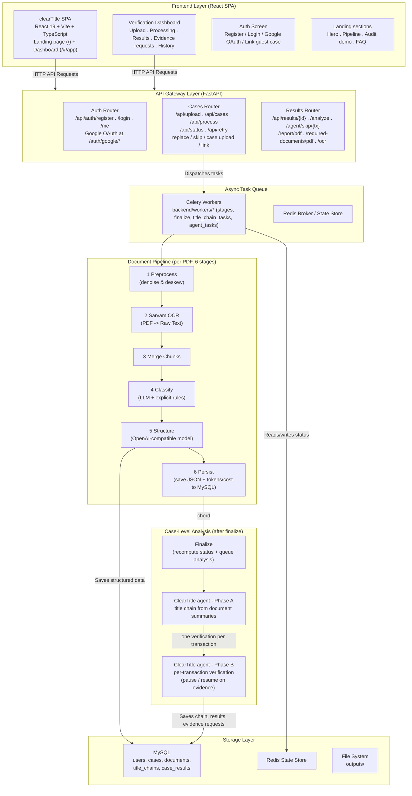

# clearTitle — AI Property Title Verification

An end-to-end property title verification platform for **Karnataka property documents**. clearTitle extracts structured JSON from scanned PDFs using Sarvam OCR and an OpenAI-compatible document processor, then hands the case to a tool-using **ClearTitle agent** that reconstructs the title chain and verifies every transaction against its own instrument — pausing to request missing evidence instead of guessing.

---

## Highlights

- **Agent-driven verification, not keyword matching** — the agent decides which documents to read from summaries alone; the application enforces process guarantees (full-OCR gate, ownership checks, workflow order) but never suggests candidates.
- **Read what you rely on** — every selected document must be read in full (100% of its OCR text) before it can support a completed result; citations are validated against what was actually read.
- **Honest pauses** — when evidence is missing, the agent pauses the transaction with a specific, compact request list (parties, dates, registration references) instead of marking an unresolved transaction verified.
- **Chain-aware** — each transaction defers to its verified upstream link; downstream reports are refreshed when an upstream state changes, without re-reading any OCR.
- **Professional PDF output** — a legal-style Title Verification Report and a per-case outstanding-documents checklist, both generated from persisted results.
- **No misleading success on failure** — if verification cannot complete (e.g. a temporary LLM outage), the case is marked `error` and the dashboard shows a clear retry state; no fabricated green checks.

---

## System Architecture



### Key Components

| Component | Technology | Description |
|---|---|---|
| **Frontend** | React 19, Vite 6, TypeScript, Tailwind CSS 4 | Landing page + dashboard with AI pipeline view, per-transaction results, evidence-request cards, and case history |
| **API Layer** | FastAPI, Uvicorn | Async REST API with JWT auth (plus optional Google OAuth) for cases, documents, results, and analysis |
| **Async Tasks** | Celery, Redis | Idempotent background stages — preprocess, OCR, merge, classify, structure, persist, finalize, agent analysis |
| **OCR Service** | Sarvam AI Vision OCR | High-accuracy OCR for mixed English/Kannada text; chunks >10-page PDFs with overlap |
| **Document processing** | OpenAI-compatible API | Classification and full-text schema-based extraction |
| **Verification agent** | OpenAI by default (`GPT-6 Luna`); Gemini optional | Tool-calling agent: title chain (Phase A) + per-transaction verification (Phase B) with pause/resume |
| **Relational DB** | MySQL | Unified tables for users, cases, documents, title chains, and verification results |

---

## How Verification Works

Verification is a two-phase agent workflow. The application's job is to make dishonest shortcuts impossible; the agent's job is to reason over evidence.

### Phase A — Title chain

The agent reads **document summaries only** (never raw OCR) and produces:

- the **property identity** (survey number, location, extent, current owners), and
- the **title chain**: an ordered list of transactions linking the current owners back to the origin.

Encumbrance certificates participate in the chain (a ledger row may become an EC-only chain link when its instrument was not uploaded), but ECs are **never transaction-verification evidence** — they are excluded from Phase B entirely.

### Phase B — Per-transaction verification

Each transaction is verified in its own agent session, in a fixed order:

1. **Load the transaction** — the claims to test, plus any saved upstream result supplied as dependency context.
2. **Record evidence requirements** — what documentary evidence this transaction type needs (locked once documents are listed).
3. **List documents** — summaries only. There is no keyword matcher and no candidate suggestion; the agent alone decides what looks relevant.
4. **Select and read** — only this transaction's own instrument plus documents it uniquely depends on. Every selected document must be read **in full** (chunked OCR reads up to 60,000 chars per call) before it can support a result.
5. **Save or pause** — a terminal result (`VERIFIED_WITH_AVAILABLE_EVIDENCE`, `ISSUES_IDENTIFIED`, `INCONCLUSIVE`) or a pause (`PENDING_NOT_VERIFIED`) with an explicit list of required documents.

### The guarantees (application-enforced)

| Guarantee | Rule |
|---|---|
| **Full-OCR gate** | A completed result is rejected unless every selected document was read end-to-end in this session |
| **Selection scope** | Other transactions' instruments and later chain events cannot be selected or read; upstream recitals defer to the verified upstream result |
| **Root-transaction rule** | At the chain's root there is no upstream link — the vendors' pre-chain title documents recited by the instrument (a prior deed, a will) *are* this transaction's evidence |
| **Ownership check** | A required-document request can only belong to the transaction under investigation |
| **Workflow order** | Requirements must be recorded before listing; listing before selecting; selecting before reading |
| **Citation validation** | Every citation must point at a case document that was fully read (or retained from the transaction's own prior result) |
| **No misleading completion** | `PENDING_NOT_VERIFIED` requires at least one concrete requested document; the UI never advances past an unserved evidence request |

### Pause, resume, skip

- **Pause** — the transaction saves `PENDING_NOT_VERIFIED` with `required_documents` (compact, identifier-dense labels such as `POA — Manohar & Prakash Kalkundrikar → Girish Siddappa Nemagoudar, ref BEL-1-07200-2007-08`, each with a one-line reason). The dashboard shows the requests; the user uploads the documents.
- **Resume** — re-running analysis (`POST /api/results/{case_id}/analyze`) continues from the paused transaction with the new evidence. Citations retained from the prior result do not need re-reading; new ones do.
- **Skip** — the user can explicitly skip a paused transaction (`POST /api/results/{case_id}/agent/skip/{tx_ref}`, by `tx_id` or sequence). Skipping is navigation state only — it never rewrites the verification result.
- **Downstream refresh** - when an upstream link's state changes, downstream reports get their `## Earlier transactions` section rewritten (one small model call, no OCR reads); when every upstream link is verified, the stale section is removed deterministically.

### Result contract (schema v3.0)

Each transaction result is stored with:

| Field | Content |
|---|---|
| `status` | `VERIFIED_WITH_AVAILABLE_EVIDENCE` / `ISSUES_IDENTIFIED` / `INCONCLUSIVE` / `PENDING_NOT_VERIFIED` |
| `report` | Markdown recording **the verification performed** — what was tested and confirmed, contradicted, or left unestablished — with `[doc_id p.X-Y]` citations. Not a digest of the instrument. |
| `cited_documents` | Flat list of `{doc_id, pages}` mirrored from the report's citations |
| `required_documents` | Outstanding evidence requests (only while paused), each with `document_type`, `reason`, `for_transaction` |
| `reviewed_document_ids` | Documents whose full OCR was reviewed |
| `transaction_metadata` | Chain position, parties, dates, registration particulars, and the upstream `chain_context` snapshot |

---

## Supported Document Types

| Category | Types |
|---|---|
| **Ownership & Transfer** | `SALE_DEED`, `GIFT_DEED`, `PARTITION_DEED` |
| **Government Registry** | `ENCUMBRANCE_CERTIFICATE` (EC), `PROPERTY_REGISTER_CARD` (PRC) |
| **Municipal & Tax** | `KHATA`, `PROPERTY_TAX_ASSESSMENT`, `TAX_RECEIPT`, `E_PAYMENT_RECEIPT` |
| **Revenue & Clearances** | `MUTATION`, `CONVERSION_ORDER`, `POSSESSION_CERTIFICATE` |
| **Legal & Others** | `RTC_PAHANI`, `LEGAL_HEIR_CERTIFICATE`, `COURT_ORDER` |

Extraction uses 18 hand-written JSON schemas (plus two completion-certificate subtype variants and a generic fallback for unknown types). Classification runs an LLM over a bounded OCR prefix with deterministic rules for known formats such as Karnataka Form 9 and issuer-specific completion certificates. A document classified as unrelated is marked for user action.

---

## Quick Start (Docker)

> **Only requirement:** [Docker Desktop](https://www.docker.com/products/docker-desktop/) installed. No Python, MySQL, or Redis needed on your machine.

### 1. Clone and configure

```bash
git clone https://github.com/MyMane24/clearTitle.git
cd clearTitle
cp .env.example .env
```

Open `.env` and fill in the API keys (everything else works as-is):

```env
SARVAM_API_KEY=your_key_here
OPENAI_API_KEY=your_key_here
DOCUMENT_PROCESSOR_MODEL=gpt-6-luna

# Verification agent (OpenAI by default)
CLEARTITLE_AGENT_PROVIDER=openai
CLEARTITLE_AGENT_MODEL=GPT-6 Luna

# Optional: use Gemini for the verification agent instead
# CLEARTITLE_AGENT_PROVIDER=gemini
# GEMINI_API_KEY=your_key_here

# Optional: Google OAuth ("Continue with Google")
# GOOGLE_CLIENT_ID=...
# GOOGLE_CLIENT_SECRET=...
# GOOGLE_REDIRECT_URI=http://localhost:8000/auth/google/callback
```

### 2. Start everything

```bash
docker compose up --build
```

This starts 5 services automatically:

| Service | URL / Port | Purpose |
|---|---|---|
| **App (FastAPI + React SPA)** | http://localhost:8000 | Main application — open `/#/app` for the dashboard |
| **phpMyAdmin** | http://localhost:8080 | Browse MySQL data in browser |
| **MySQL** | `127.0.0.1:3307` | Database (exposed for GUI tools) |
| **Redis** | internal only | Celery broker + state store |
| **Celery Worker** | internal only | Background task processing (`--concurrency=2`) |

On subsequent runs just use `docker compose up`. Rebuild with `docker compose up --build` after changing code — the React SPA is baked into the image. A rebuild replaces the `:latest` tag, so tag the current image before a risky change (see [Backup & Rollback](#backup--rollback)).

### 3. Verify a case

1. Open `/#/app`, upload the property PDFs, and press **Process**.
2. Watch the six-stage pipeline run live (`/api/status/{case_id}`).
3. When the agent starts, each transaction is verified in turn. If evidence is missing, the transaction **pauses** and the dashboard lists exactly what to upload.
4. Upload the requested documents, press **Analyze** to resume, or **Skip** to continue without them.
5. Download the **Title Verification Report** (PDF) or the **outstanding-documents checklist** (PDF) from the results view.

---

## Frontend Development (Without Docker)

The React app lives in `frontend/`. It has its own dev server (Express + Vite HMR) on port 3000:

```bash
cd frontend
npm install
npm run dev            # http://localhost:3000
```

| Command | Description |
|---|---|
| `npm run dev` | Dev server (Express + Vite middleware) on :3000 |
| `npm run build` | Build the Vite frontend + bundle the server to `dist/` |
| `npm run lint` | Type-check with `tsc --noEmit` |
| `npm run test` | Unit tests for the results rendering layer (`node --test` + tsx) |
| `npm start` | Run the production server from `dist/` |

When deployed via Docker, the built SPA is served by FastAPI from `frontend/dist`.

---

## Inspecting the Database

### Option A — phpMyAdmin (browser, zero install)

Open **http://localhost:8080** — you'll see all tables (`users`, `cases`, `documents`, `title_chains`, `case_results`, `case_memory`) and can browse/query data directly.

### Option B — MySQL Workbench / DBeaver / TablePlus

```
Host:     127.0.0.1
Port:     3307
User:     root
Password: password
Database: property_ocr_v2
```

### Option C — Terminal

```bash
docker compose exec mysql mysql -u root -ppassword property_ocr_v2
```

---

## API Endpoints

### Auth
| Method | Endpoint | Description |
|---|---|---|
| `POST` | `/api/auth/register` | Register a new account |
| `POST` | `/api/auth/login` | Log in, returns a JWT |
| `GET` | `/api/auth/me` | Current user (requires Bearer token) |
| `GET` | `/auth/google/login` | Start Google OAuth (optional, when configured) |
| `GET` | `/auth/google/callback` | Google OAuth callback |

### Pipeline & Cases
| Method | Endpoint | Description |
|---|---|---|
| `GET` | `/api/cases` | List cases (requires auth) |
| `POST` | `/api/upload` | Upload PDFs and initialize a new case |
| `POST` | `/api/process/{case_id}` | Trigger the async OCR + structuring pipeline |
| `GET` | `/api/status/{case_id}` | Real-time pipeline status (progress, log, verification status) |
| `POST` | `/api/retry/{case_id}` | Retry failed documents |
| `POST` | `/api/case/{case_id}/upload` | Add more documents to an existing case |
| `POST` | `/api/case/{case_id}/link` | Link a guest case to the logged-in account |
| `POST` | `/api/case/{case_id}/doc/{doc_id}/replace` | Replace a document file |
| `POST` | `/api/case/{case_id}/doc/{doc_id}/skip` | Mark a document as skipped |
| `GET` | `/api/case/{case_id}/doc/{doc_id}/pdf` | Serve the original PDF (authenticated, opens in new tab) |
| `DELETE` | `/api/case/{case_id}` | Delete a single case (MySQL + files) |

### Results & Analysis
| Method | Endpoint | Description |
|---|---|---|
| `GET` | `/api/results/{case_id}` | Full results payload: case info, documents + structured JSON, title chain, per-transaction verification |
| `POST` | `/api/results/{case_id}/analyze` | (Re)run or **resume** the ClearTitle agent for a case |
| `POST` | `/api/results/{case_id}/agent/skip/{tx_ref}` | Skip a paused transaction (`tx_id` or 1-based sequence) and continue the agent |
| `GET` | `/api/results/{case_id}/report/pdf` | Download the PDF Title Verification Report |
| `GET` | `/api/results/{case_id}/required-documents/pdf` | Download the outstanding-documents checklist (PDF) |
| `GET` | `/api/results/{case_id}/ocr` | Raw OCR full text for every document in the case |

### Misc
| Method | Endpoint | Description |
|---|---|---|
| `GET` | `/health` | Health check + API-key presence |
| `GET` | `/` | React SPA (built) or `frontend/index.html` |

Most case endpoints accept an optional JWT. Guest (anonymous) cases work without auth, but case data can only be accessed by its owner once linked.

---

## The Document Pipeline

Every uploaded PDF goes through **6 stages**, each its own idempotent Celery task, chained and joined by a **chord** that runs one chain per document in parallel:

```
DOC_001 --> preprocess --> ocr --> merge --> classify --> structure --> persist --+
DOC_002 --> preprocess --> ocr --> merge --> classify --> structure --> persist --+--> finalize --> ClearTitle agent
DOC_003 --> preprocess --> ocr --> merge --> classify --> structure --> persist --+
```

| # | Stage | Work |
|---|---|---|
| 1 | **Preprocess** | CLAHE contrast, denoise, deskew, sharpen via OpenCV (non-fatal: falls back to raw PDF) |
| 2 | **OCR** | Sarvam OCR (Kannada+English); <=10 pages one job, >10 pages overlapping 10-page chunks in parallel |
| 3 | **Merge** | Deduplicate overlapping pages, re-join split tables, strip base64 blobs |
| 4 | **Classify** | LLM classifies a bounded OCR prefix; deterministic rules handle known formats |
| 5 | **Structure** | OpenAI-compatible model extracts the full OCR into the matching JSON schema |
| 6 | **Persist** | Save JSON + tokens/cost/model to MySQL, write final file to `outputs/` |

**Then, once** (case level):

| Stage | Work |
|---|---|
| **Finalize** | Recompute case status (`complete` / `partial` / `failed`), release the pipeline lock, and queue the analysis only when every document structured |
| **ClearTitle agent** | Phase A builds the title chain from summaries; Phase B verifies each transaction on its own instrument with full-OCR evidence, pausing for missing documents |

The dashboard polls `/api/status/{case_id}` through the analysis phase and shows per-transaction results, evidence requests, and the final verdict as they arrive.

---

## Project Structure

```
clearTitle/
├-- backend/                        # FastAPI + Celery
│   ├-- main.py                     # FastAPI entrypoint (API + React SPA)
│   ├-- celery_app.py               # Celery config (acks_late, timeouts, retries)
│   ├-- config.py                   # ALL env vars in one place
│   ├-- logger.py                   # Logging utility
│   │
│   ├-- prompts/                    # Versioned LLM prompts (editable .txt files)
│   │   ├-- loader.py               #   load_prompt() helper
│   │   ├-- title_chain_system.txt  #   Phase A: shared chain-agent instructions
│   │   ├-- title_chain_task.txt    #   Phase A: property identity + title chain task
│   │   ├-- agent_system.txt        #   Phase B: shared verification-agent instructions
│   │   ├-- agent_verify_task.txt   #   Phase B: per-transaction workflow + result contract
│   │   ├-- agent_summary.txt       #   Per-document navigation summaries
│   │   └-- agent_dependency_refresh.txt  # Downstream "## Earlier transactions" rewrite
│   │
│   ├-- skills/                     # Procedural playbooks the agent loads on demand
│   │   ├-- title_chain/skill.md    #   Chain construction rules
│   │   └-- transaction_verification/skill.md  # Evidence-quality and verification rules
│   │
│   ├-- routers/                    # HTTP layer (thin: validate -> call service)
│   │   ├-- auth.py                 #   /register, /login, /me, Google OAuth
│   │   ├-- cases.py                #   upload, process, status, retry, replace, skip, delete
│   │   └-- results.py              #   /results/{id}, /analyze, /agent/skip, PDFs, /ocr
│   │
│   ├-- services/                   # Business logic (no HTTP, no Celery)
│   │   ├-- orchestrator.py         #   builds Celery chains + chords
│   │   ├-- document_processor.py   #   classification + full-text extraction
│   │   ├-- cleartitle_agent.py     #   agent workflow: Phase A/B, pause/resume, locks
│   │   ├-- agent_runtime.py        #   tool loop, budgets, retries, recoverable errors
│   │   ├-- agent_tools.py          #   the agent's tool handlers + enforcement gates
│   │   ├-- agent_schemas.py        #   canonical Pydantic contracts (v3.0) + validation
│   │   ├-- extract.py              #   OCR retry + structured output paths
│   │   ├-- report.py               #   PDF title verification report renderer
│   │   ├-- results.py              #   assemble /api/results payload
│   │   ├-- auth.py                 #   JWT + bcrypt helpers
│   │   └-- schemas/                #   per-doc-type JSON extraction schemas
│   │       ├-- static.py           #     18 hand-written JSON schemas
│   │       └-- generic.py          #     fallback schema for unknown types
│   │
│   ├-- workers/                    # Celery layer (thin task wrappers)
│   │   ├-- tasks.py                #   6 idempotent stage tasks
│   │   ├-- stages.py               #   the actual stage logic (preprocess->persist)
│   │   ├-- stage_adapter.py        #   task -> stage.invoke adapter
│   │   ├-- stage_base.py           #   stage task base class
│   │   ├-- idempotency.py          #   skip-already-done guard
│   │   ├-- finalize.py             #   chord callback: recompute status + queue analysis
│   │   ├-- title_chain_tasks.py    #   queues the ClearTitle agent analysis task
│   │   ├-- agent_tasks.py          #   resume / skip-transaction tasks
│   │   └-- context.py              #   StageContext (dependencies handed to stages)
│   │
│   ├-- domain/state_machine.py     # Stage enum + status->stage mapping (pure logic)
│   │
│   ├-- integrations/               # Adapters to external/plumbing systems
│   │   ├-- llm/                    #   provider-agnostic agent LLM + rate limiter
│   │   ├-- ocr/                    #   sarvam_client, ocr_merger, preprocessor
│   │   ├-- redis/                  #   client, state_store, lock
│   │   └-- storage/                #   file_utils, file_service
│   │
│   ├-- database/
│   │   ├-- connection.py           #  MySQL connection helper
│   │   ├-- migrations.py           #  DDL bootstrap (runs at startup)
│   │   └-- repositories/           #  SQL access (case, document, title_chain,
│   │                               #  agent, verification_results, user)
│   │
│   ├-- shared/constants.py         # doc-type + status string constants
│   ├-- shared/ec_ledger.py         # EC page-split row recombinator (read-boundary fix)
│   └-- tests/                      # pytest suite (148 tests)
│
├-- frontend/                       # React SPA (Vite)
│   ├-- src/
│   │   ├-- components/             # Landing-page sections (Navbar, Hero, FAQ, ...)
│   │   ├-- dashboard/              # Verification dashboard (upload, results, history, auth)
│   │   │   ├-- VerificationDashboard.tsx    # Main dashboard with AI pipeline view
│   │   │   ├-- TransactionResultCard.tsx    # Per-transaction report + citations + requests
│   │   │   ├-- transactionResults.ts        # v3.0 result normalization + markdown rendering
│   │   │   └-- dashboard.css                # All dashboard styles + pipeline animations
│   │   ├-- api/backend.ts          # API client (JWT auth, typed responses)
│   │   ├-- data/                   # Landing content
│   │   ├-- App.tsx                 # Route: homepage / + dashboard /#/app
│   │   ├-- index.css               # Tailwind theme + brand fonts
│   │   └-- main.tsx
│   ├-- public/                     # Favicon, static assets
│   ├-- server.ts                   # Dev server (Express + Vite middleware)
│   └-- index.html
│
├-- outputs/                        # PDFs + structured outputs (bind-mounted, persists across restarts, NOT in git)
├-- uploads/                        # Original uploaded PDFs (bind-mounted, NOT in git)
├-- backups/                        # Local mysqldump snapshots (NOT in git)
├-- docs/                           # Local-only design notes (gitignored — not in a fresh clone)
├-- ARCHITECTURE.md                 # In-depth design doc: contracts, gates, workflow, history
├-- docker-compose.yml              # 5 services: api, worker, mysql, redis, phpmyadmin
├-- Dockerfile                      # Multi-stage build (Node 20 builds SPA → Python 3.11 runtime)
├-- requirements.txt                # Python dependencies
└-- .env                            # Environment variables (not committed)
```

---

## LLM Prompts & Skills

Prompts are versioned text files in `backend/prompts/`; procedural playbooks live in `backend/skills/`. Document classification and extraction instructions live in `backend/services/document_processor.py` alongside their rule-based exceptions.

| File | Phase | Purpose |
|---|---|---|
| `title_chain_system.txt` | A | Shared chain-agent reasoning and tool policy |
| `title_chain_task.txt` | A | Property identity + title-chain construction task |
| `agent_system.txt` | B | Shared verification-agent reasoning and tool policy |
| `agent_verify_task.txt` | B | Per-transaction workflow, SELECTION SCOPE, and the v3.0 result contract |
| `agent_summary.txt` | A/B | Per-document navigation summaries |
| `agent_dependency_refresh.txt` | post-B | Rewrites a downstream report's `## Earlier transactions` section after an upstream state change |
| `skills/title_chain/skill.md` | A | Chain-construction playbook (loaded on demand) |
| `skills/transaction_verification/skill.md` | B | Evidence-quality and "verify, do not transcribe" playbook |

Load helper: `from backend.prompts.loader import load_prompt`

### Agent guardrails (config)

| Setting | Default | Meaning |
|---|---|---|
| `CLEARTITLE_AGENT_PROVIDER` | `openai` | `openai` or `gemini` |
| `CLEARTITLE_AGENT_MODEL` | `GPT-6 Luna` | Agent + document-processor model |
| `CLEARTITLE_VERIFY_MODEL_CALL_BUDGET` | `16` | Model calls per transaction before an extension is required |
| `CLEARTITLE_VERIFY_MODEL_CALL_MAX` | `24` | Hard cap (16 + one 8-call extension) |
| `CLEARTITLE_AGENT_MAX_RAW_CHARS` | `60000` | Max OCR chars per `get_document_text` call |
| `CLEARTITLE_AGENT_MAX_ATTEMPTS` | `5` | Retry attempts on recoverable provider errors |

---

## Tests

```bash
pytest backend/tests          # 148 tests — contracts, gates, runtime, repos, report
cd frontend
npm run test                  # 20 tests — result normalization + rendering
npm run lint                  # tsc --noEmit
```

The backend suite locks the agent's behavioral contract: the full-OCR gate, selection scope, ownership and workflow-order checks, citation validation, the compact request style, and the v3.0 result shape are all asserted against the real handlers — not mocks of them.

---

## API Costs

| Provider | Model | Cost per case (3 docs) |
|---|---|---|
| **Sarvam AI** | OCR (Vision) | Free tier: 10,000 chars/call |
| **OpenAI-compatible API** | Configured document/agent models | Usage-based; depends on model and document size |
| **Google Gemini (optional)** | Configured agent model | Usage-based; only when selected for the verification agent |

---

## UI Design System

The frontend follows a warm, editorial design system shared by the landing page and dashboard:

- **Palette** — Cream background (`#FFF8F2`), warm stone neutrals, and an orange brand scale (`#ea580c`, `#f97316`, amber `#fbbf24`). Semantic status colors (emerald / amber / rose) for verification results.
- **Typography** — Inter (body), Plus Jakarta Sans (display/headings), Instrument Serif (accent italics).
- **Icons** — lucide-react (no emoji).
- **Dashboard** (`/#/app`) — Custom CSS (`dashboard.css`) with CSS-token theming: cards, badges, metric tiles, AI pipeline view with pulsing animations, title-chain timeline, per-transaction verification cards with citation chips and evidence-request lists, and case history sidebar.

---

## Backup & Rollback

The app is three independent layers. Each needs its own undo — `git` covers only the first.

| Layer | What it is | Recovered by |
|---|---|---|
| **Code** | `backend/`, `frontend/` | `git reset --hard <tag>` |
| **Running build** | Docker image — code **+ baked-in React SPA** | `docker tag` a known image back onto `:latest` |
| **Data** | MySQL `property_ocr_v2`, plus `outputs/` | `mysqldump` / file copy |

`git reset` alone does **not** roll back the running app: the React bundle is compiled into the image, and MySQL is never touched by git.

### What is not in version control

| Path | In git? | Consequence |
|---|---|---|
| `.env` | No (secrets) | Must be backed up separately, stored securely |
| `outputs/` | No | OCR text + structured JSON. **Irreplaceable** — recovering it means re-running paid OCR |
| `uploads/` | No | Original scanned PDFs. Re-uploadable from your own copies |
| `backups/` | No | Local dump snapshots (see below) |

### Take a database snapshot

```bash
mkdir -p backups                                    # Windows PowerShell: New-Item -ItemType Directory backups
docker compose exec -T mysql sh -c 'mysqldump -u root -p"$MYSQL_ROOT_PASSWORD" \
  --single-transaction --skip-lock-tables --no-tablespaces \
  --default-character-set=utf8mb4 --routines --triggers \
  --set-gtid-purged=OFF property_ocr_v2 > /tmp/db.sql'
docker compose cp mysql:/tmp/db.sql "backups/db-$(date +%F-%H%M%S).sql"
```

Why each flag matters:

| Flag | Reason |
|---|---|
| `--single-transaction` | Consistent snapshot of InnoDB tables with **no table locks** — the app keeps serving during the dump |
| `--skip-lock-tables` | Belt-and-braces: never take a global read lock |
| `--default-character-set=utf8mb4` | Kannada party names survive the round-trip |
| no `--databases` | Omits `CREATE DATABASE`/`USE`, so a restore can only touch the database you name explicitly |
| `docker compose cp` | Avoids piping binary through the host shell — PowerShell redirection corrupts UTF-8 |

### Restore a snapshot

> **This replaces the current contents of the target database** (the dump contains `DROP TABLE IF EXISTS`). Stop the app first and keep a fresh snapshot of anything you want to keep.

```bash
# 1. take a snapshot of the CURRENT state before overwriting it
# 2. stop everything that writes to MySQL
docker compose stop api worker

# 3. copy the dump in and restore it
docker compose cp backups/db-2026-10-05-pre-big-change.sql mysql:/tmp/restore.sql
docker compose exec -T mysql sh -c 'mysql -u root -p"$MYSQL_ROOT_PASSWORD" \
  -D property_ocr_v2 < /tmp/restore.sql'

docker compose up -d
```

### Roll back the running build

`docker compose up --build` overwrites the `:latest` tag, so a rebuild makes the previously working image unreachable. Name the image **before** you start changing things:

```bash
docker tag cleartitle-api:latest   cleartitle-api:<commit-sha>     # e.g. 68a4aaa
docker tag cleartitle-worker:latest cleartitle-worker:<commit-sha>
```

Later, to return to it without rebuilding:

```bash
docker tag cleartitle-api:<commit-sha>    cleartitle-api:latest
docker tag cleartitle-worker:<commit-sha> cleartitle-worker:latest
docker compose up -d --force-recreate --no-build
```

Always confirm an image really contains the code you think it does — a build from a dirty working tree can look fine while missing your newest commits:

```bash
# Linux / macOS
docker create --name chk cleartitle-api:<commit-sha>
docker cp chk:/app/backend/services/report.py /tmp/report.py
git hash-object /tmp/report.py
git rev-parse <commit-sha>:backend/services/report.py   # the two hashes must match
docker rm chk
```

```powershell
# Windows PowerShell
docker create --name chk cleartitle-api:<commit-sha>
docker cp chk:/app/backend/services/report.py "$env:TEMP\report.py"
git hash-object "$env:TEMP\report.py"
git rev-parse <commit-sha>:backend/services/report.py
docker rm chk
```

### Known-good baselines

| Date | Git tag / commit | Notes |
|---|---|---|
| **2026-10-29** | `working-2026-10-29` → `68a4aaa` | Schema v3.0 evidence contract, agent-only selection, compact single-pause requests, PDF fixes. Validated: 148/148 backend, 20/20 frontend, live case 390E1B54 end-to-end, full no-LLM runtime audit. |
| 2026-10-05 | `pre-big-change` → `b1196fc` | Pre-agent pipeline baseline. DB dump: `backups/db-2026-10-05-pre-big-change.sql` |

> `docker-compose.yml` sets no `image:` key, so `docker compose build` always writes to `:latest`. Tag explicitly before a risky change, as above.

---

## Manual Setup (Backend, Without Docker)

<details>
<summary>Click to expand — for local backend development without Docker</summary>

**Prerequisites:** Python 3.11+, MySQL 8.0, Redis

### Step 1 — Create the database

```sql
CREATE DATABASE IF NOT EXISTS property_ocr_v2
  CHARACTER SET utf8mb4 COLLATE utf8mb4_unicode_ci;
```

### Step 2 — Configure environment

```bash
# Windows
copy .env.example .env

# Linux / macOS
cp .env.example .env
```

Update these values to match your local MySQL:

```env
MYSQL_HOST=127.0.0.1
MYSQL_PORT=3306
MYSQL_USER=root
MYSQL_PASSWORD=your_mysql_password
MYSQL_DATABASE=property_ocr_v2
REDIS_URL=redis://localhost:6379/0
```

### Step 3 — Install dependencies

```bash
python -m venv venv
# Windows:  .\venv\Scripts\Activate.ps1
# Linux/macOS: source venv/bin/activate
pip install -r requirements.txt
```

### Step 4 — Run the application (3 terminals)

**Terminal 1 — Redis:** `redis-server`

**Terminal 2 — Celery Worker:**

Windows:
```powershell
.\venv\Scripts\celery.exe -A backend.celery_app worker --loglevel=info --pool=solo --concurrency=1
```
Linux / macOS:
```bash
celery -A backend.celery_app worker --loglevel=info --concurrency=2
```

**Terminal 3 — FastAPI Server:**

Windows:
```powershell
.\venv\Scripts\uvicorn.exe backend.main:app --reload --port 8000
```
Linux / macOS:
```bash
uvicorn backend.main:app --reload --port 8000
```

Open **http://localhost:8000** in your browser.

</details>

---

## Documentation

- **[ARCHITECTURE.md](ARCHITECTURE.md)** — the in-depth design reference: system diagrams, the agent workflow and its enforcement gates, the v3.0 result contract, prompt/skill layout, the downstream refresh protocol, and the full change history.

---

*Last updated: 29 October 2026*
